# The Founders — Logical ERD v1.1

```mermaid
erDiagram
  ORGANISATIONS ||--o{ ORGANISATIONS : parent_of
  ORGANISATIONS ||--o| VENTURE_PROFILES : has_profile
  MEMBERS ||--o| USERS : authenticates
  MEMBERS ||--o{ ROLE_ASSIGNMENTS : assigned
  ORGANISATIONS ||--o{ ROLE_ASSIGNMENTS : scopes
  MEMBERS ||--o| FOUNDING_INTERESTS : holds
  ORGANISATIONS ||--o{ FOUNDING_INTERESTS : parent_portfolio
  ORGANISATIONS ||--o{ VENTURE_OWNERSHIP : venture
  ORGANISATIONS ||--o{ CAPITAL_ALLOCATIONS : deploys
  ORGANISATIONS ||--o{ BANK_ACCOUNTS : owns
  BANK_ACCOUNTS ||--o{ BANK_SIGNATORIES : mandates
  MEMBERS ||--o{ CONTRIBUTIONS : makes
  CONTRIBUTION_TYPES ||--o{ CONTRIBUTIONS : classifies
  INVESTMENT_PROJECTS ||--o{ MEMBER_INVESTMENTS : receives
  MEMBERS ||--o{ MEMBER_INVESTMENTS : invests
  ORGANISATIONS ||--o{ CHART_OF_ACCOUNTS : defines
  CHART_OF_ACCOUNTS ||--o{ JOURNAL_LINES : posts_to
  JOURNAL_ENTRIES ||--|{ JOURNAL_LINES : contains
  ORGANISATIONS ||--o{ JOURNAL_ENTRIES : records
  LOANS ||--o{ LOAN_REPAYMENTS : receives
  LOANS ||--o{ LOAN_PENALTY_CHARGES : accrues
  LOAN_REPAYMENTS ||--o{ LOAN_REPAYMENT_ALLOCATIONS : allocates
  WELFARE_EVENTS ||--o{ WELFARE_CONTRIBUTIONS : funded_by
  ORGANISATIONS ||--o{ EMPLOYEES : employs
  PAYROLL_RUNS ||--o{ PAYROLL_ITEMS : contains
  ORGANISATIONS ||--o{ SALES : records
  SALES ||--|{ SALE_ITEMS : contains
  ORGANISATIONS ||--o{ PURCHASES : records
  ORGANISATIONS ||--o{ EXPENSES : incurs
  ORGANISATIONS ||--o{ PRODUCTS : offers
  PRODUCTS ||--o{ STOCK_MOVEMENTS : moves
  ORGANISATIONS ||--o{ ASSETS : owns
  ORGANISATIONS ||--o{ LIABILITIES : owes
  MEETINGS ||--o{ RESOLUTIONS : considers
  RESOLUTIONS ||--o{ VOTES : receives
  USERS ||--o{ AUDIT_LOGS : performs
```

## Main modelling principles
- Organisation hierarchy: one parent record; venture records reference the parent.
- Identity: a member is a person; a user is a login identity; roles are scoped to an organisation.
- Founding interests: eleven equal ownership units are stored separately from the rounded display percentage of 9.1%.
- Venture ownership: legal ownership of a venture by the parent is recorded separately from founders' interests in the parent portfolio.
- Finance separation: chama, member investments, venture capital and welfare are different contribution classes.
- Accounting: each organisation has its own chart of accounts and journal entries; consolidated reports aggregate controlled entity data.
- Operations: sales, purchases, stock, suppliers, customers, assets, liabilities and payroll are organisation-scoped.
- Governance: meetings, resolutions, votes, approvals and audit logs retain decision history.
